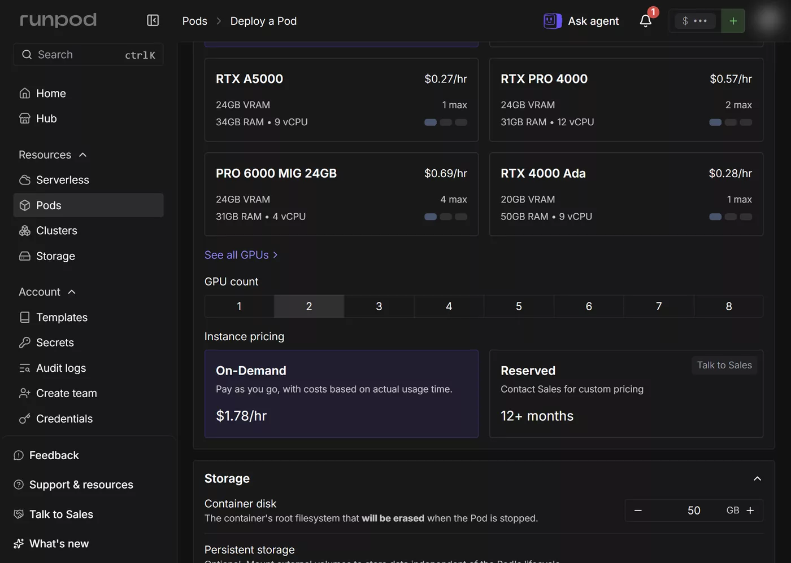
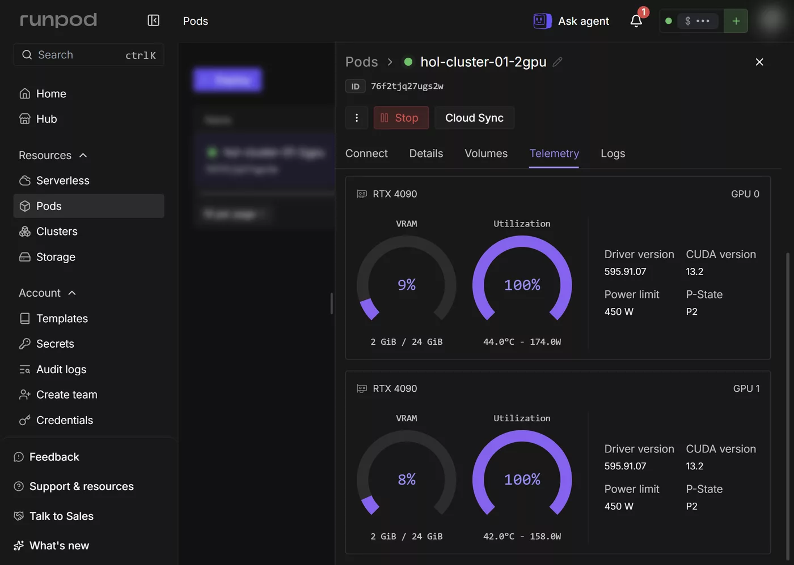
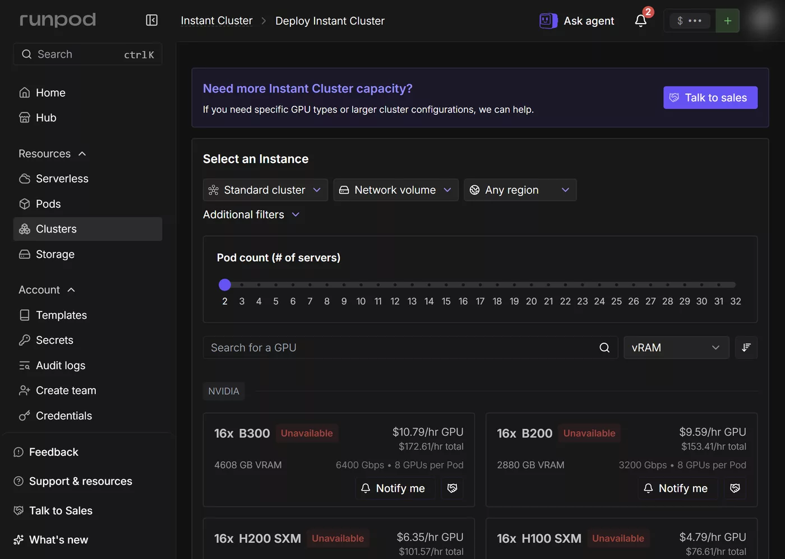
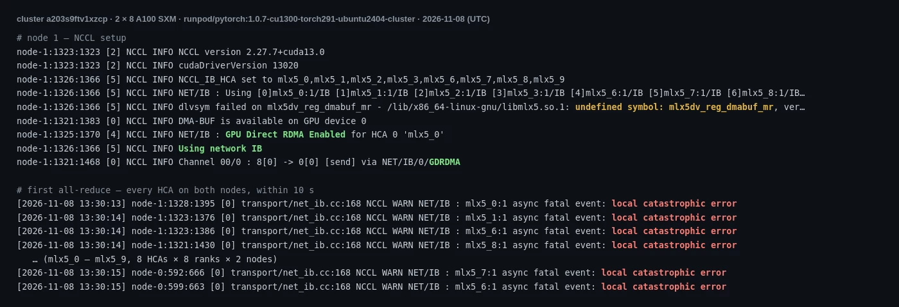

# Cluster Lab 01 — PyTorch Distributed: `torchrun` and NCCL

[English](#english) | [한국어](#한국어)

---

## English

**Goal:** measure how fast GPUs exchange gradients, first inside one Pod, then across the nodes of an Instant Cluster, and see what that does to data-parallel training.

**Time:** ~15 minutes per Pod · **Cost:** stage 1 about USD 0.40 on 2026-11-07 (two Pods, 7 and 3 minutes); stage 2 about USD 20 on 2026-11-07 (2 × 8 A100 SXM for 35 minutes) and about USD 43 on 2026-11-08 (rerun, 75 minutes; [#52](https://github.com/litkhai/runpod-hols/issues/52))

### Files

| File | Role |
|---|---|
| `nccl_bench.py` | All-reduce sweep, 1 MiB – 1 GiB, over NCCL; reports `algbw` and `busbw` with the nccl-tests definitions |
| `ddp_train.py` | 101 M-parameter MLP on synthetic data under `DistributedDataParallel`; about 400 MB of fp32 gradients to all-reduce per step |
| `run.sh` | Runs inside a Pod or on every cluster node: topology (`nvidia-smi topo -m`, interfaces), then `nccl_bench.py`, then `ddp_train.py` on 1 GPU and on all GPUs |
| `lab.py` | Stage 1 over the REST API: create a multi-GPU Pod, copy the scripts, run, fetch `results/`, delete |
| `cluster.py` | Stage 2 over GraphQL: wait for stock, create the cluster, watchdog delete at 75 min, run both nodes, fetch, delete |
| `results/<tag>/` | What each run produced |

On a cluster, Runpod sets `NUM_NODES`, `NUM_TRAINERS`, `NODE_RANK`, `PRIMARY_ADDR` and `PRIMARY_PORT`; `run.sh` passes them to `torchrun` and sets `NCCL_SOCKET_IFNAME=ens1`, because `eth0` (172.x) is for internet traffic only ([configuration](https://docs.runpod.io/instant-clusters/configuration)). On a single Pod those variables are absent and it runs one node.

### Stage 1 — one Pod, two GPUs

```bash
cd cluster/01-pytorch-distributed
python3 lab.py create                                  # 2x RTX 4090, Secure Cloud
python3 lab.py show                                    # wait for the SSH line
python3 lab.py push && python3 lab.py run 2x4090 && python3 lab.py pull
python3 lab.py delete
python3 lab.py create --gpu "NVIDIA A100-SXM4-80GB"     # then the same with tag 2xA100SXM
```

Image `runpod/pytorch:1.0.7-cu1281-torch291-ubuntu2404` (torch 2.9.1, NCCL 2.27.5). Stage 2 now uses the cluster image `runpod/pytorch:1.0.7-cu1300-torch291-ubuntu2404-cluster`.

| | 2x RTX 4090 | 2x A100 SXM 80GB |
|---|---|---|
| Price | USD 1.78/hr | USD 3.58/hr |
| Link between the GPUs (`topo -m`) | `SYS`: PCIe across two NUMA nodes | `NV12`: 12 NVLinks |
| NCCL transport (log) | `SHM/direct` — through host memory | `P2P/CUMEM/read` — GPU to GPU |
| all-reduce `busbw`, 1 MiB | 10.9 GB/s | 18.2 GB/s |
| all-reduce `busbw`, 1 GiB | **15.6 GB/s** | **201.0 GB/s** |
| DDP, 1 GPU | 39,453 samples/s (6.5 ms/step) | 23,132 samples/s (11.1 ms/step) |
| DDP, 2 GPUs | 16,244 samples/s (31.5 ms/step) | 41,871 samples/s (12.2 ms/step) |
| Scaling efficiency (2 GPUs / 2 × 1 GPU) | **0.21** | **0.91** |

What the numbers say:

- **Two RTX 4090s trained 2.4× slower than one.** Each step all-reduces about 400 MB of gradients; at 15.6 GB/s that alone is about 26 ms, against 6.5 ms of compute. The two cards sat on different NUMA nodes (`SYS`), and consumer GeForce cards do not do GPU-to-GPU P2P, so NCCL staged the data through host shared memory.
- **The A100 pair scaled at 91%.** Over NVLink the same 400 MB moves in about 2 ms, so a step grew only from 11.1 to 12.2 ms.
- **The single A100 was slower than the single 4090** on this model: the script runs plain fp32 matrix multiplies with TF32 off (the PyTorch default), where the 4090 has more fp32 throughput. The A100's case is TF32/BF16 and the link, not fp32.
- **GPU utilization does not show it.** During the 2x 4090 run the console showed both GPUs at 100% (screenshot below) while most of each step was waiting on the transfer: NCCL kernels occupy the GPU while they wait.
- Per dollar, one RTX 4090 (39,453 samples/s at USD 0.89/hr) beat both pairs for this model. More GPUs pay only when the link keeps up with the gradient size.

Raw files: [`results/2x4090/`](./results/2x4090/), [`results/2xA100SXM/`](./results/2xA100SXM/).

### Four H100 SXM in one Pod

While no cluster was in stock, a single Pod with four H100 SXM was (stock "Low"; the first 19 create attempts over ten minutes got *"no instances currently available"*):

```bash
python3 lab.py create --gpu "NVIDIA H100 80GB HBM3" --count 4   # then push, run 4xH100SXM, pull, delete
```

| 2026-11-08, US-NE-1 | 4x H100 SXM 80GB |
|---|---|
| Price | USD 15.96/hr |
| Link (`topo -m`) | `NV18`: 18 NVLinks between every pair |
| all-reduce `busbw`, 1 MiB / 1 GiB | 11.1 / **356.3 GB/s** |
| DDP, 1 GPU | 54,981 samples/s (4.7 ms/step) |
| DDP, 4 GPUs | 179,442 samples/s (5.7 ms/step) |
| Scaling efficiency (4 GPUs / 4 × 1 GPU) | **0.82** |

- **The link is 1.8× the A100 pair's** (356 against 201 GB/s at 1 GiB), and one H100 trains this fp32 model 2.4× as fast as one A100.
- **Efficiency fell to 0.82 from 0.91** because the compute got faster than the link: 4.7 ms of compute against about 1 ms of all-reduce per step. The faster the GPU, the more the link decides.
- This is the in-node ceiling a cluster has to be compared with: the socket run of stage 2 reached 0.32 GB/s between nodes, a thousandth of it.

The Pod ran 11.5 minutes, about USD 3. Raw files: [`results/4xH100SXM/`](./results/4xH100SXM/).




### Stage 2 — Instant Cluster, 2 nodes × 8 GPUs

Created in the console (**Clusters → Create cluster**) or over GraphQL: the REST API has no cluster endpoints, but `createCluster` and `deleteCluster` exist (found 2026-11-07; introspection is off, so the input fields below were read from validation errors). Pricing read from the form on 2026-11-07: A100 SXM USD 2.15 per GPU-hour, USD 34.37/hr for the smallest cluster (2 Pods × 8 GPUs, 1600 Gbps between nodes); H100 SXM USD 4.79 (USD 76.61/hr); H200 USD 6.35; B200 USD 9.59; B300 USD 10.79.

**On 2026-11-07 every type was Unavailable**, while single A100 SXM and H100 SXM Pods could be deployed. The console reads availability from GraphQL `gpuTypes { lowestPrice(input: {isCluster: true, podCount: 2, gpuCount: 8, …}) { stockStatus } }`; `stockStatus` is `null` when the form says Unavailable. That evening A100 SXM showed `Available` from about 19:29 to 19:36 KST and was gone again by 19:46: stock comes and goes within minutes, so waiting for it is a job for a script.



`cluster.py` does the whole stage unattended:

```bash
python3 cluster.py stock                      # stockStatus and price per GPU-hour
python3 cluster.py auto auto --hours 48 --gpus "NVIDIA A100-SXM4-80GB,NVIDIA H100 80GB HBM3"
#   wait for whichever type comes first, then everything below; tag auto -> 2x8x<GPU>-cluster
```

`auto` checks stock every 2 minutes; when A100 SXM is available it calls

```graphql
createCluster(input: {clusterName: "hol-cluster-01", gpuTypeId: "NVIDIA A100-SXM4-80GB", podCount: 2,
  gpuCountPerPod: 8, type: TRAINING, imageName: "runpod/pytorch:1.0.7-cu1281-torch291-ubuntu2404",
  containerDiskInGb: 50, volumeInGb: 0, ports: "22/tcp", startSsh: true}) { id pods { id } }
```

(`type` takes `TRAINING` or `SLURM`), starts a detached watchdog that runs `deleteCluster(input: {id})` 75 minutes later whatever happens, waits for SSH on both nodes, runs `run.sh` on both at once (the cluster variables are read from the container's PID 1, since an SSH session does not inherit them), fetches `results/`, and deletes the cluster. It refuses to create anything above USD 80/hr, the account's spend limit (H100: USD 76.61/hr). Manual steps: `create`, `show`, `push`, `run <tag>`, `pull`, `delete`.

**`deployCost` is required.** Without it `createCluster` fails with *"The requested price 0 is less than the current minimum price (14.32)"*. The minimum is per Pod, and `deployCost` is for the whole cluster: 14.32 came back as *"requested price 7.16"*, so `cluster.py` offers the minimum × `podCount` (28.64). The Pods were then billed at the list price, USD 17.184/hr each (USD 34.37/hr), not at the offer.

### Stage 2 run — sockets instead of InfiniBand

| Step | Time (KST) |
|---|---|
| A100 SXM `Available` again | 21:42 |
| `createCluster` accepted | 21:48:04 |
| SSH open on both nodes | 21:49:59 (114 s) |
| `run.sh` on both nodes, exit 0 / 0 | 21:50:14 – 22:08:55 |
| Second run after installing `libibverbs` | 22:09:23 – stopped 22:20 |
| `deleteCluster` | 22:23:04 |

Both nodes had eight NVLinked A100s (`NV12`), twelve Mellanox HCAs (`mlx5_0`–`mlx5_11`) and `ens1` on 10.65.0.0/24; Runpod sets `NCCL_IB_HCA` to the eight HCAs next to the GPUs.

| 16 GPUs, image as is | Result |
|---|---|
| NCCL network | **`Socket` over `ens1`**: *"Failed to open libibverbs.so[.1]"* |
| all-reduce `busbw`, 1 GiB | **0.32 GB/s** (best 0.68 GB/s at 32 MiB) |
| DDP, 1 GPU | 23,497 samples/s (10.9 ms/step) |
| DDP, 16 GPUs | **1,105 samples/s (3,705 ms/step)** |
| Scaling efficiency | 0.003 |

- **The image has no RDMA user space.** `runpod/pytorch:1.0.7-cu1281-torch291-ubuntu2404` lacks `libibverbs`, so NCCL fell back to TCP sockets on `ens1`. Inside each node it still used NVLink (`P2P/CUMEM`); between the nodes every gradient went over sockets.
- **Sixteen GPUs trained 21× slower than one.** About 400 MB of gradients per step over 0.3 GB/s is more than a second each way; a step took 3.7 s against 11 ms of compute.
- **Installing the library from Ubuntu did not fix it.** After `apt-get install libibverbs1 ibverbs-providers` NCCL picked `IB` on all eight HCAs with GPU Direct RDMA, and then every HCA reported *"async fatal event: local catastrophic error"*; the all-reduce made no progress in ten minutes. At the time this looked like a mismatch between Ubuntu's rdma-core and the host's driver; Runpod later traced it to a host hardware fault (see the rerun below). The console's cluster templates use a separate image, `runpod/pytorch:1.0.7-cu1300-torch291-ubuntu2404-cluster` (template *Runpod Pytorch 2.9.0 for clusters*), and `cluster.py` now creates the next cluster with it.
- Whatever image you use, check the NCCL log for `Using network IB` before you trust the numbers: the fallback to `Socket` is silent and the job still finishes.

Raw files: [`results/2x8xA100SXM-socket/`](./results/2x8xA100SXM-socket/) (with `nccl-transport.txt`, `timeline.json`), [`results/2x8xA100SXM-ib/nccl-ib.txt`](./results/2x8xA100SXM-ib/nccl-ib.txt).

### Stage 2 rerun — the cluster image, InfiniBand fails

`cluster.py auto` waited a day for stock and ran again with the console's cluster image, `runpod/pytorch:1.0.7-cu1300-torch291-ubuntu2404-cluster` (NCCL 2.27.7, CUDA driver 13.2).

| Step | Time (KST, 2026-11-08) |
|---|---|
| A100 SXM `Available`, `createCluster` accepted (`a203s9ftv1xzcp`) | 22:28:37 – 22:28:39 |
| SSH open on both nodes | 22:29:29 (50 s) |
| First all-reduce: every HCA reports *"local catastrophic error"* | 22:30:13 – 22:30:23 |
| `run.sh` stopped by its 40-minute timeout, no progress | 23:09:53 |
| Watchdog `deleteCluster` | about 23:43 (75 min, about USD 43) |



- **The RDMA setup itself worked.** NCCL found the eight HCAs (200 Gb/s InfiniBand each, LIDs assigned, queue pairs connected), logged `Using network IB` and chose GPU Direct RDMA through DMA-BUF (`via NET/IB/N/GDRDMA`).
- **The first transfer killed every HCA.** All eight HCAs on both nodes raised *"async fatal event: local catastrophic error"* within ten seconds, as seen from every rank. There is no bandwidth figure and no DDP step. The first run with Ubuntu's `libibverbs` failed the same way, so the image was not the cause.
- **Cause: a host hardware fault (Runpod support, 2026-11-09).** Runpod checked both clusters. At both times (2026-11-07 about 13:09 UTC, 2026-11-08 about 13:30 UTC) each host had a fatal PCIe error that disconnected all of its devices at once: the GPUs, the NVSwitches, the storage and every InfiniBand card. The *"local catastrophic error"* lines are the HCAs dropping off in that failure. It was not the NCCL configuration, the InfiniBand settings or the image, and support advised against changing NCCL settings (such as `NCCL_NET_GDR_LEVEL=LOC`) because of it. The machines were taken out of service, so a new cluster is placed on other hosts.
- **The earlier guess was wrong.** Before the answer, the logs were read as a failure of the GPU Direct RDMA path: the container's `libmlx5` has no `mlx5dv_reg_dmabuf_mr` (NCCL logs *"dlvsym failed"*), so GPU buffers were registered through the generic DMA-BUF call. That message is real but harmless here.
- **A host fault shows up as a hang.** Inside the container nothing exits with an error; the collective just stops, and the cluster keeps billing. The 40-minute run timeout and the 75-minute watchdog in `cluster.py` are what limited the loss. If this repeats on a new cluster, Runpod asks for the cluster ID and the UTC time.
- **#52 closes as a recorded failure.** As of 2026-11-08 this lab has no multi-node bandwidth figure on a Runpod Instant Cluster. Two clusters cost about USD 63.

Raw files: [`results/2x8xA100SXM-cluster/nccl-ib.txt`](./results/2x8xA100SXM-cluster/nccl-ib.txt) (excerpt of both nodes' NCCL logs), [`timeline.json`](./results/2x8xA100SXM-cluster/timeline.json).

---

## 한국어

**목표:** GPU 끼리 기울기를 얼마나 빨리 주고받는지 Pod 한 대 안에서, 그다음 Instant Cluster 의 노드 사이에서 재고, 그것이 데이터 병렬 학습에 어떤 영향을 주는지 본다.

**시간:** Pod 당 약 15분 · **비용:** 1단계는 2026-11-07 기준 약 USD 0.40 (Pod 두 대, 7분과 3분). 2단계는 2026-11-07 기준 약 USD 20 (A100 SXM 2 × 8장, 35분), 2026-11-08 재실행 약 USD 43 (75분. [#52](https://github.com/litkhai/runpod-hols/issues/52))

### 파일

| 파일 | 역할 |
|---|---|
| `nccl_bench.py` | NCCL all-reduce 를 1 MiB – 1 GiB 로 측정. nccl-tests 와 같은 정의의 `algbw`, `busbw` |
| `ddp_train.py` | 합성 데이터로 도는 1억 1백만 파라미터 MLP, `DistributedDataParallel`. 스텝마다 fp32 기울기 약 400 MB 를 all-reduce |
| `run.sh` | Pod 안 또는 클러스터의 모든 노드에서 실행: 토폴로지(`nvidia-smi topo -m`, 인터페이스), `nccl_bench.py`, `ddp_train.py` 1 GPU 와 전체 GPU |
| `lab.py` | REST API 로 하는 1단계: 멀티 GPU Pod 생성, 스크립트 복사, 실행, `results/` 회수, 삭제 |
| `cluster.py` | GraphQL 로 2단계: 재고 대기, 클러스터 생성, 75분 감시 삭제, 두 노드 실행, 회수, 삭제 |
| `results/<tag>/` | 실행마다 나온 결과 |

클러스터에서는 Runpod 이 `NUM_NODES`, `NUM_TRAINERS`, `NODE_RANK`, `PRIMARY_ADDR`, `PRIMARY_PORT` 를 넣어 준다. `run.sh` 는 이를 `torchrun` 에 넘기고 `NCCL_SOCKET_IFNAME=ens1` 을 설정한다. `eth0`(172.x) 는 인터넷용이기 때문이다 ([configuration](https://docs.runpod.io/instant-clusters/configuration)). 단일 Pod 에서는 이 변수가 없으므로 노드 1개로 돈다.

### 1단계 — Pod 한 대, GPU 두 장

```bash
cd cluster/01-pytorch-distributed
python3 lab.py create                                  # RTX 4090 두 장, Secure Cloud
python3 lab.py show                                    # SSH 줄이 나올 때까지
python3 lab.py push && python3 lab.py run 2x4090 && python3 lab.py pull
python3 lab.py delete
python3 lab.py create --gpu "NVIDIA A100-SXM4-80GB"     # 이어서 태그 2xA100SXM 로 같은 순서
```

이미지 `runpod/pytorch:1.0.7-cu1281-torch291-ubuntu2404` (torch 2.9.1, NCCL 2.27.5). 2단계는 이제 클러스터용 이미지 `runpod/pytorch:1.0.7-cu1300-torch291-ubuntu2404-cluster` 를 쓴다.

| | RTX 4090 두 장 | A100 SXM 80GB 두 장 |
|---|---|---|
| 가격 | USD 1.78/hr | USD 3.58/hr |
| GPU 사이 연결 (`topo -m`) | `SYS`: NUMA 노드 두 개에 걸친 PCIe | `NV12`: NVLink 12개 |
| NCCL 전송 방식 (로그) | `SHM/direct` — 호스트 메모리 경유 | `P2P/CUMEM/read` — GPU 간 직접 |
| all-reduce `busbw`, 1 MiB | 10.9 GB/s | 18.2 GB/s |
| all-reduce `busbw`, 1 GiB | **15.6 GB/s** | **201.0 GB/s** |
| DDP, GPU 1장 | 초당 39,453 샘플 (스텝 6.5 ms) | 초당 23,132 샘플 (스텝 11.1 ms) |
| DDP, GPU 2장 | 초당 16,244 샘플 (스텝 31.5 ms) | 초당 41,871 샘플 (스텝 12.2 ms) |
| 확장 효율 (2장 / 2 × 1장) | **0.21** | **0.91** |

숫자가 말하는 것:

- **RTX 4090 두 장이 한 장보다 2.4배 느렸다.** 스텝마다 기울기 약 400 MB 를 all-reduce 하는데, 15.6 GB/s 로는 그것만 약 26 ms 다. 계산은 6.5 ms 였다. 두 카드는 서로 다른 NUMA 노드에 있었고(`SYS`), GeForce 카드는 GPU 간 P2P 를 하지 않으므로 NCCL 이 호스트 공유 메모리를 거쳐 보냈다.
- **A100 두 장은 91% 로 확장됐다.** NVLink 로는 같은 400 MB 가 약 2 ms 에 오가므로 스텝이 11.1 ms 에서 12.2 ms 로만 늘었다.
- **이 모델에서는 A100 한 장이 4090 한 장보다 느렸다.** 스크립트는 TF32 를 끈 (PyTorch 기본값) 순수 fp32 행렬곱인데, fp32 처리량은 4090 이 더 높다. A100 의 강점은 TF32/BF16 과 링크이지 fp32 가 아니다.
- **GPU 사용률로는 보이지 않는다.** 4090 두 장 실행 중 콘솔은 두 GPU 모두 100% 로 보여줬지만(아래 캡처) 실제로는 스텝 대부분이 전송 대기였다. NCCL 커널은 기다리는 동안에도 GPU 를 점유한다.
- 달러당으로는 이 모델에서 RTX 4090 한 장(USD 0.89/hr 에 초당 39,453)이 두 조합보다 나았다. GPU 를 늘리는 것은 링크가 기울기 크기를 감당할 때만 이득이다.

원본: [`results/2x4090/`](./results/2x4090/), [`results/2xA100SXM/`](./results/2xA100SXM/).

### Pod 한 대에 H100 SXM 4장

클러스터 재고가 없을 때도 H100 SXM 4장짜리 Pod 한 대는 재고가 있었다 (재고 "Low". 처음 10분 동안 19번의 생성 시도는 *"no instances currently available"* 로 거절됐다):

```bash
python3 lab.py create --gpu "NVIDIA H100 80GB HBM3" --count 4   # 이어서 push, run 4xH100SXM, pull, delete
```

| 2026-11-08, US-NE-1 | H100 SXM 80GB 4장 |
|---|---|
| 가격 | 시간당 USD 15.96 |
| 연결 (`topo -m`) | `NV18`: 모든 쌍 사이 NVLink 18개 |
| all-reduce `busbw`, 1 MiB / 1 GiB | 11.1 / **356.3 GB/s** |
| DDP, GPU 1장 | 54,981 samples/s (스텝 4.7 ms) |
| DDP, GPU 4장 | 179,442 samples/s (스텝 5.7 ms) |
| 확장 효율 (4장 / 1장 × 4) | **0.82** |

- **연결은 A100 두 장의 1.8배** (1 GiB 에서 356 대 201 GB/s) 이고, 이 fp32 모델에서 H100 한 장은 A100 한 장의 2.4배 속도로 학습했다.
- **효율이 0.91 에서 0.82 로 떨어졌다.** 계산이 연결보다 빨라졌기 때문이다: 스텝마다 계산 4.7 ms 에 all-reduce 약 1 ms. GPU 가 빠를수록 연결이 성능을 좌우한다.
- 클러스터와 비교할 노드 안의 천장이 이것이다. 2단계의 소켓 실행은 노드 사이 0.32 GB/s 로, 그 1000분의 1 이었다.

Pod 는 11.5분, 약 USD 3. 원본: [`results/4xH100SXM/`](./results/4xH100SXM/).


### 2단계 — Instant Cluster, 노드 2개 × GPU 8장

콘솔 (**Clusters → Create cluster**) 이나 GraphQL 로 만든다. REST API 에는 클러스터 엔드포인트가 없지만 `createCluster`, `deleteCluster` 가 있다 (2026-11-07 확인. 인트로스펙션이 꺼져 있어 아래 입력 필드는 검증 오류 메시지로 알아냈다). 2026-11-07 화면의 가격: A100 SXM GPU 시간당 USD 2.15, 가장 작은 클러스터(Pod 2개 × GPU 8장, 노드 간 1600 Gbps) 시간당 USD 34.37. H100 SXM USD 4.79 (시간당 USD 76.61), H200 USD 6.35, B200 USD 9.59, B300 USD 10.79.

**2026-11-07 에는 모든 종류가 Unavailable 이었다.** 같은 시각 A100 SXM, H100 SXM 단일 Pod 는 배포할 수 있었다. 콘솔은 가용 여부를 GraphQL `gpuTypes { lowestPrice(input: {isCluster: true, podCount: 2, gpuCount: 8, …}) { stockStatus } }` 로 읽고, 화면이 Unavailable 일 때 `stockStatus` 는 `null` 이다. 같은 날 저녁 A100 SXM 이 한국 시간 약 19:29–19:36 에 `Available` 이었다가 19:46 에는 다시 사라졌다. 재고는 몇 분 단위로 나고 빠지므로, 기다리는 일은 스크립트에 맡긴다.


`cluster.py` 가 이 단계를 사람 없이 끝까지 진행한다:

```bash
python3 cluster.py stock                      # stockStatus 와 GPU 시간당 가격
python3 cluster.py auto auto --hours 48 --gpus "NVIDIA A100-SXM4-80GB,NVIDIA H100 80GB HBM3"
#   먼저 재고가 나온 종류로 아래를 모두 진행. 태그 auto -> 2x8x<GPU>-cluster
```

`auto` 는 2분마다 재고를 확인하고, A100 SXM 이 나오면 위의 영어 절에 있는 `createCluster` 를 호출한다 (`type` 은 `TRAINING` 또는 `SLURM`). 그다음 무슨 일이 있어도 75분 뒤 `deleteCluster(input: {id})` 를 부르는 분리된 감시 프로세스를 띄우고, 두 노드의 SSH 를 기다려 `run.sh` 를 동시에 돌린다 (SSH 세션은 클러스터 변수를 물려받지 않으므로 컨테이너 PID 1 에서 읽는다). 이어서 `results/` 를 받아 오고 클러스터를 지운다. 시간당 USD 80 (계정의 지출 상한. H100 은 USD 76.61) 을 넘는 것은 만들지 않는다. 수동 단계: `create`, `show`, `push`, `run <tag>`, `pull`, `delete`.

**`deployCost` 가 필요하다.** 빼면 `createCluster` 가 *"The requested price 0 is less than the current minimum price (14.32)"* 로 거절된다. 최소 가격은 Pod 당이고 `deployCost` 는 클러스터 전체 값이다. 14.32 를 넣으면 *"requested price 7.16"* 으로 나뉘어 돌아오므로, `cluster.py` 는 최소 가격 × `podCount` (28.64) 로 요청한다. 실제 청구는 요청 값이 아니라 정가, Pod 당 시간당 USD 17.184 (전체 USD 34.37) 였다.

### 2단계 실행 — InfiniBand 대신 소켓

| 단계 | 시각 (KST) |
|---|---|
| A100 SXM 이 다시 `Available` | 21:42 |
| `createCluster` 수락 | 21:48:04 |
| 두 노드 SSH 열림 | 21:49:59 (114초) |
| 두 노드에서 `run.sh`, 종료 코드 0 / 0 | 21:50:14 – 22:08:55 |
| `libibverbs` 설치 후 두 번째 실행 | 22:09:23 – 22:20 중단 |
| `deleteCluster` | 22:23:04 |

두 노드 모두 NVLink 로 묶인 A100 8장 (`NV12`), Mellanox HCA 12개 (`mlx5_0`–`mlx5_11`), 10.65.0.0/24 의 `ens1` 을 가졌다. Runpod 은 `NCCL_IB_HCA` 를 GPU 옆의 HCA 8개로 설정해 둔다.

| GPU 16장, 이미지 그대로 | 결과 |
|---|---|
| NCCL 네트워크 | **`ens1` 위의 `Socket`**: *"Failed to open libibverbs.so[.1]"* |
| all-reduce `busbw`, 1 GiB | **0.32 GB/s** (최고 0.68 GB/s, 32 MiB) |
| DDP, GPU 1장 | 23,497 samples/s (스텝 10.9 ms) |
| DDP, GPU 16장 | **1,105 samples/s (스텝 3,705 ms)** |
| 확장 효율 | 0.003 |

- **이미지에 RDMA 사용자 공간 라이브러리가 없다.** `runpod/pytorch:1.0.7-cu1281-torch291-ubuntu2404` 에는 `libibverbs` 가 없어서 NCCL 이 `ens1` 의 TCP 소켓으로 내려갔다. 노드 안에서는 여전히 NVLink (`P2P/CUMEM`) 를 썼지만, 노드 사이의 그래디언트는 모두 소켓으로 갔다.
- **GPU 16장이 1장보다 21배 느렸다.** 스텝마다 약 400 MB 의 그래디언트를 0.3 GB/s 로 주고받으니 한 방향에만 1초가 넘는다. 계산 11 ms 에 스텝은 3.7초였다.
- **Ubuntu 패키지로 라이브러리를 넣어도 해결되지 않았다.** `apt-get install libibverbs1 ibverbs-providers` 뒤 NCCL 은 HCA 8개 모두에서 GPU Direct RDMA 와 함께 `IB` 를 골랐지만, 곧 모든 HCA 가 *"async fatal event: local catastrophic error"* 를 냈고 all-reduce 는 10분 동안 진척이 없었다. 당시에는 Ubuntu 의 rdma-core 와 호스트 드라이버가 맞지 않는 것으로 보았지만, 나중에 Runpod 이 호스트 하드웨어 장애로 확인했다 (아래 재실행 참고). 콘솔의 클러스터 템플릿은 별도 이미지 `runpod/pytorch:1.0.7-cu1300-torch291-ubuntu2404-cluster` (*Runpod Pytorch 2.9.0 for clusters*) 를 쓰며, `cluster.py` 는 다음 클러스터를 이 이미지로 만든다.
- 어떤 이미지를 쓰든, 수치를 믿기 전에 NCCL 로그에서 `Using network IB` 를 확인한다. `Socket` 으로 내려가도 경고 없이 작업은 끝난다.

원본 파일: [`results/2x8xA100SXM-socket/`](./results/2x8xA100SXM-socket/) (`nccl-transport.txt`, `timeline.json` 포함), [`results/2x8xA100SXM-ib/nccl-ib.txt`](./results/2x8xA100SXM-ib/nccl-ib.txt).

### 2단계 재실행 — 클러스터용 이미지, InfiniBand 실패

`cluster.py auto` 가 하루 동안 재고를 기다렸다가 콘솔의 클러스터용 이미지 `runpod/pytorch:1.0.7-cu1300-torch291-ubuntu2404-cluster` (NCCL 2.27.7, CUDA 드라이버 13.2) 로 다시 돌았다.

| 단계 | 시각 (KST, 2026-11-08) |
|---|---|
| A100 SXM `Available`, `createCluster` 수락 (`a203s9ftv1xzcp`) | 22:28:37 – 22:28:39 |
| 두 노드 SSH 열림 | 22:29:29 (50초) |
| 첫 all-reduce: 모든 HCA 가 *"local catastrophic error"* | 22:30:13 – 22:30:23 |
| `run.sh` 가 진척 없이 40분 제한에 걸려 중단 | 23:09:53 |
| 감시 프로세스가 `deleteCluster` | 약 23:43 (75분, 약 USD 43) |


- **RDMA 설정 자체는 됐다.** NCCL 은 HCA 8개(각 200 Gb/s InfiniBand, LID 할당, 큐 페어 연결)를 찾았고 `Using network IB` 를 남겼으며, DMA-BUF 를 통한 GPU Direct RDMA 를 골랐다 (`via NET/IB/N/GDRDMA`).
- **첫 전송에서 모든 HCA 가 멈췄다.** 두 노드의 HCA 8개가 모두 10초 안에 *"async fatal event: local catastrophic error"* 를 냈고, 모든 rank 에서 같은 줄이 찍혔다. 대역폭 수치도 DDP 스텝도 없다. Ubuntu 의 `libibverbs` 를 쓴 첫 실행도 똑같이 실패했으므로 이미지가 원인은 아니었다.
- **원인: 호스트 하드웨어 장애 (Runpod 지원팀, 2026-11-09).** Runpod 이 두 클러스터를 확인했다. 두 시각 (2026-11-07 약 13:09 UTC, 2026-11-08 약 13:30 UTC) 모두 각 호스트에서 치명적인 PCIe 오류가 나 GPU, NVSwitch, 스토리지, InfiniBand 카드 전부가 한꺼번에 끊겼다. *"local catastrophic error"* 는 그 장애로 HCA 가 떨어져 나가며 남긴 줄이다. NCCL 설정, InfiniBand 설정, 이미지 탓이 아니며, 지원팀은 이 일 때문에 NCCL 설정 (`NCCL_NET_GDR_LEVEL=LOC` 등) 을 바꾸지 말라고 했다. 해당 머신은 서비스에서 빠졌고, 새 클러스터는 다른 호스트에 배치된다.
- **앞서 한 추측은 틀렸다.** 답변 전에는 로그를 GPU Direct RDMA 경로의 실패로 읽었다. 컨테이너의 `libmlx5` 에 `mlx5dv_reg_dmabuf_mr` 가 없어 (NCCL 이 *"dlvsym failed"* 를 남김) GPU 버퍼가 일반 DMA-BUF 호출로 등록된 것은 사실이지만, 이번 실패와는 관계없다.
- **호스트 장애는 멈춤으로 나타난다.** 컨테이너 안에서는 아무것도 오류로 끝나지 않고 집합 통신만 멈추며, 그동안 클러스터 요금은 계속 나간다. 손실을 막은 것은 `cluster.py` 의 40분 실행 제한과 75분 감시 프로세스였다. 새 클러스터에서 같은 일이 생기면 Runpod 은 클러스터 ID 와 UTC 시각을 보내 달라고 한다.
- **#52 는 실패로 기록하고 닫는다.** 2026-11-08 기준 이 실습에는 Runpod Instant Cluster 의 다중 노드 대역폭 수치가 없다. 클러스터 두 번에 약 USD 63 이 들었다.

원본 파일: [`results/2x8xA100SXM-cluster/nccl-ib.txt`](./results/2x8xA100SXM-cluster/nccl-ib.txt) (두 노드 NCCL 로그 발췌), [`timeline.json`](./results/2x8xA100SXM-cluster/timeline.json).
