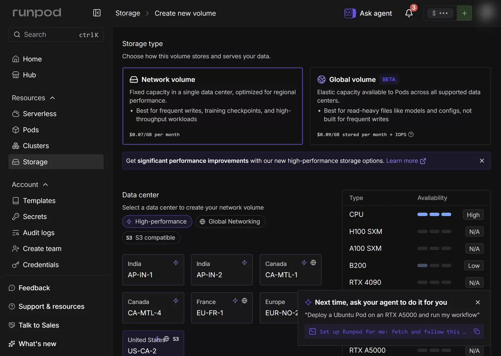

# Storage on Runpod — Every Tier Measured

[English](#english) | [한국어](#한국어)

Site page: <https://runpod.litkhai.dev/readings/storage/> (EN/KO/ZH/JA).

| File | Role |
|---|---|
| `bench.sh` | One fio method for any mount: `bash bench.sh <label> <dir> 2G` inside a Pod |
| `results/bench_2026-11-07.jsonl` | Every run behind the tables below, with Pod, datacenter and client |

---

## English

Every Runpod product sits on the same handful of storage tiers, and they are not what their names suggest: the "Pod volume" is a network filesystem, the "high-performance" volume is a different storage system in a different datacenter, and the global volume is an object store behind FUSE. This note puts all of them through one benchmark, checks what happens when two writers share a volume, and measures where model weights should live for a Serverless cold start.

Everything here was run on 2026-11-07 ([#64](https://github.com/litkhai/runpod-hols/issues/64), [#69](https://github.com/litkhai/runpod-hols/issues/69)). Scripts and raw results are in this folder.

## The tiers
{: #tiers }

| Tier | What it actually is (2026-11-07) | Lives | Price | Attach |
|---|---|---|---|---|
| Container disk | `overlay` on the host's local NVMe | Until the Pod stops | In the Pod price | Always there |
| Pod volume ("Volume disk", legacy) | MooseFS over FUSE (`mfs#euro-3.runpod.net`) in EU-RO-1 | Until the Pod is deleted | USD 0.10/GB-month running, 0.20 stopped | `volumeInGb` |
| Network volume, standard | The same MooseFS | Until you delete it | USD 0.07/GB-month (0.05 beyond 1 TB) | `networkVolumeId`, one datacenter |
| Network volume, high-performance | A VAST NFS server (`us-ca-2-vast.runpod.net:/runpodfs`) | Until you delete it | USD 0.14/GB-month | GraphQL only (`isNextGenStorage: true`) |
| Global volume (beta) | An object store over FUSE (`fuse.geesefs`, 1.0P) | Until you delete it | USD 0.09/GB-month + IOPS | GraphQL only (`volumeMounts`, `OBJECT_STORE_VOLUME`) |

*Create new volume, High-performance filter: seven datacenters, only US-CA-2 also S3-compatible. Picking one switches the volume to high-performance at USD 0.14/GB-month — twice standard. The filter's tooltip promises "up to 2x faster"; the docs say "up to 3x throughput and 4x IOPS".*

Three API surfaces are involved, and none covers everything. REST v1 creates standard network volumes and attaches them to Pods; GraphQL (what the console uses) is the only way to create a high-performance volume or attach a global volume; global volumes themselves are created through `POST https://api.runpod.io/v2/global-volumes`.

**Passing both kinds to one GraphQL deploy drops the network volume.** `podFindAndDeployOnDemand` with `networkVolumeId` *and* a global volume in `volumeMounts` started a Pod with only the global volume; `/workspace` was the container disk, and nothing reported an error. Check `df -T /workspace` after every deploy.

## One benchmark for every tier
{: #benchmark }

`storage/bench.sh` runs the same fio jobs on each mount: 2 GiB sequential write and read with 1 MiB blocks, 30 s of 4 KiB random read and write at queue depth 16 (direct I/O wherever the filesystem accepts it), and 1,000 4 KiB files created and synced.

| Tier | Client | Seq write | Seq read | 4K rand read | 4K rand write | Small files |
|---|---|---|---|---|---|---|
| Container disk | GPU Pod, EU-RO-1 | 4.3–4.5 GB/s | 4.6 GB/s | ~190–204k IOPS | ~165–188k IOPS | ~1,250/s |
| Pod volume | GPU Pod, EU-RO-1 | 1.6 GB/s | 1.2 GB/s | 9.9k IOPS | 51k IOPS | 67/s |
| Network volume, standard | GPU and CPU Pods, EU-RO-1 | 2.0–2.3 GB/s | 1.45–1.5 GB/s | 7.5–8.1k IOPS | 48k IOPS | 66–74/s |
| Network volume, high-performance | CPU Pod, US-CA-2 | 0.18 GB/s | 0.65 GB/s | 16k IOPS | 5.1k IOPS | 113/s |
| Global volume | GPU Pod, EU-RO-1 | 0.19 GB/s | (cache, see below) | 64k IOPS | 17k IOPS | 1,100/s |

What the table says:

- **The local disk wins everything, by an order of magnitude on random reads.** ~190k IOPS against under 10k on the network volume. Anything that reads small pieces at random — a dataloader over many files, a database — belongs on the container disk.
- **The Pod volume and the standard network volume are the same system.** Same MooseFS cluster, same profile; the Pod volume is not a local disk in EU-RO-1.
- **"High-performance" was not faster in a straight line.** In US-CA-2 it doubled random reads (16k vs 8k IOPS) and was 1.6× faster on small files, but wrote sequentially at a tenth of the standard volume's speed. Datacenter and storage system change together, so this is not a pure tier comparison — but it is what you get for twice the price there.
- **The global volume caches aggressively.** Reading the 2 GiB right after writing it ran at 6.6 GB/s from local cache; a cold read of a 512 MiB file from another continent ran at 39 MiB/s ([#64](https://github.com/litkhai/runpod-hols/issues/64)).
- **CPU Pods have slow container disks.** On a `cpu3c` Pod the container disk wrote at 0.23 GB/s and read at 0.13 GB/s — slower than the network volume it was attached to.

**This replaces the mixed numbers from earlier labs.** Pod lab 02 used `dd oflag=direct` (1.6 GB/s), and the first global-volume test wrote from `/dev/urandom`, which caps near 300 MB/s on its own — so its "273 MB/s container disk" was the random generator, not the disk.

## Two writers, one volume
{: #sharing }

| | Standard network volume (EU-RO-1) | Global volume (CA-MTL-1 + EU-RO-1) |
|---|---|---|
| New file written on one side seen on the other | < 4 s | 3 s |
| Both write one file at the same moment | Both read the same final content | **Each keeps its own version**, still 45 s later |
| 200 appends from each side | All 400 lines present | Not tested |

The network volume behaves like one shared filesystem. The global volume does not: concurrent writers diverge, and nothing reports a conflict. Runpod's docs say the last write wins and recommend network volumes for shared mutable data; the measurement agrees with the recommendation, not with "last write wins". The docs also warn that writing to one network volume from several Serverless workers at once "may cause data corruption" — appends survived here, but treat it as one writer at a time.

## Where model weights should live
{: #model-weights }

Same vLLM worker (`worker-v1-vllm` v2.28.0, Qwen2.5-7B-Instruct, 14.29 GiB), RTX 4090, FlashBoot off read back, cold starts 180 s apart:

| Weights | Cold start `delayTime` | What happened to the weights |
|---|---|---|
| Downloaded every time | 96.8–123.4 s | Download 12.1–28.4 s, then load in seconds |
| Endpoint **Model** field (host cache) | **85.7–129.9 s** | No download; shards from the host in 5–46 s |
| Network volume (`/runpod-volume`) | 137.9–195.2 s | No download after the first; load 27.8–31.1 s at ~0.5 GB/s |

The network volume saved the download and then spent as long reading from MooseFS, and the cold starts came out slower overall. For a model of this size, set the endpoint's Model field ([Serverless](https://runpod.litkhai.dev/serverless/)) and leave the network volume for data that must persist and be shared — outputs, checkpoints, datasets that several Pods read. The global volume was not tried for weights: its measured cold read across regions (39 MiB/s) rules it out.

## Getting data in without a Pod — the S3 API

Network volumes in S3-capable datacenters (EU-RO-1 here) also answer at `https://s3api-<dc>.runpod.io`, with the volume id as the bucket. It needs an S3 API key from **Credentials → S3 API Keys**, separate from the Runpod API key and with read and write access to every S3-capable volume. Measured on 2026-11-07 with `aws s3 cp`, 1 GiB:

| Client | Upload | Download |
|---|---|---|
| This repo's build server, outside Runpod | 20 MiB/s | 66 MiB/s |
| A CPU Pod in the same datacenter | 30 MiB/s | 210 MiB/s |
| The same file through the Pod's mount | | 1.27 GB/s |

- **The two views are one filesystem.** A file uploaded through S3 appeared on the Pod's `/workspace` with the same sha256, and a file written in the Pod was listed by S3 straight away.
- **Uploads are slow from anywhere.** 20–30 MiB/s is about 35–50 s per GiB; 100 small files went at 20 per second. Fine for configs and adapters, slow for a 15 GB model — compare the Model field.
- **Uploaded files are `root`, mode 600** (directories 750). A container that runs as another user cannot read them until you `chmod`.
- The key is shown once and grants every S3-capable volume; delete it when done. This test's key was revoked afterwards.

## Choosing
{: #choosing }

| You need | Use |
|---|---|
| Scratch space, datasets read at random, compilation caches | Container disk |
| Model weights for a Serverless endpoint | The endpoint's Model field |
| Files that outlive the Pod in one datacenter, shared by Pods and endpoints there | Standard network volume |
| Random-read heavy work in a high-performance datacenter | High-performance volume — measure first; sequential writes were slow |
| Read-mostly files that several regions need | Global volume — one writer, expect seconds of delay |
| Data that must survive Pod deletion but needs no sharing | Pod volume is the same system as a network volume, at a higher price |

Not covered yet: Instant Cluster volumes.

---

## 한국어

Runpod 의 모든 제품은 같은 몇 가지 스토리지 계층 위에 놓여 있고, 그 실체는 이름과 다릅니다. "Pod 볼륨"은 네트워크 파일시스템이고, "고성능" 볼륨은 다른 데이터센터에 있는 다른 스토리지 시스템이며, 글로벌 볼륨은 FUSE 뒤에 있는 오브젝트 스토어입니다. 이 노트는 모든 계층을 하나의 벤치마크로 측정하고, 두 작성자가 한 볼륨을 공유할 때 어떤 일이 생기는지 확인하며, Serverless 콜드 스타트를 위해 모델 가중치를 어디에 둬야 하는지 측정합니다.

모든 항목은 2026-11-07 에 실행했습니다([#64](https://github.com/litkhai/runpod-hols/issues/64), [#69](https://github.com/litkhai/runpod-hols/issues/69)). 스크립트와 원시 결과는 this folder 에 있습니다.

## 스토리지 계층
{: #tiers-ko }

| 계층 | 실제 정체 (2026-11-07) | 수명 | 가격 | 연결 방식 |
|---|---|---|---|---|
| 컨테이너 디스크 | 호스트 로컬 NVMe 위의 `overlay` | Pod 가 중지될 때까지 | Pod 가격에 포함 | 항상 존재 |
| Pod 볼륨 ("Volume disk", 레거시) | EU-RO-1 의 FUSE 기반 MooseFS (`mfs#euro-3.runpod.net`) | Pod 가 삭제될 때까지 | 실행 중 USD 0.10/GB-월, 중지 시 0.20 | `volumeInGb` |
| 네트워크 볼륨, 표준 | 같은 MooseFS | 직접 삭제할 때까지 | USD 0.07/GB-월 (1 TB 초과분 0.05) | `networkVolumeId`, 데이터센터 하나 |
| 네트워크 볼륨, 고성능 | VAST NFS 서버 (`us-ca-2-vast.runpod.net:/runpodfs`) | 직접 삭제할 때까지 | USD 0.14/GB-월 | GraphQL 전용 (`isNextGenStorage: true`) |
| 글로벌 볼륨 (베타) | FUSE 기반 오브젝트 스토어 (`fuse.geesefs`, 1.0P) | 직접 삭제할 때까지 | USD 0.09/GB-월 + IOPS | GraphQL 전용 (`volumeMounts`, `OBJECT_STORE_VOLUME`) |

*볼륨 생성, High-performance 필터: 데이터센터 일곱 곳이며, S3 호환까지 되는 곳은 US-CA-2 뿐입니다. 이 중 하나를 고르면 볼륨이 USD 0.14/GB-월의 고성능으로 바뀝니다 — 표준의 두 배입니다. 필터의 툴팁은 "최대 2배 빠름"을, 문서는 "최대 3배 처리량, 4배 IOPS"를 약속합니다.*

관련된 API 는 세 가지이고, 어느 것도 전부를 다루지 못합니다. REST v1 은 표준 네트워크 볼륨을 만들고 Pod 에 연결합니다. GraphQL(콘솔이 쓰는 API)은 고성능 볼륨을 만들거나 글로벌 볼륨을 연결하는 유일한 방법입니다. 글로벌 볼륨 자체는 `POST https://api.runpod.io/v2/global-volumes` 로 생성합니다.

**두 종류를 한 번의 GraphQL 배포에 함께 넘기면 네트워크 볼륨이 빠집니다.** `networkVolumeId` *와* `volumeMounts` 의 글로벌 볼륨을 함께 넘긴 `podFindAndDeployOnDemand` 는 글로벌 볼륨만 붙은 Pod 를 띄웠습니다. `/workspace` 는 컨테이너 디스크였고, 어떤 오류도 보고되지 않았습니다. 배포할 때마다 `df -T /workspace` 로 확인하세요.

## 모든 계층에 같은 벤치마크
{: #benchmark-ko }

`storage/bench.sh` 는 각 마운트에서 같은 fio 작업을 실행합니다. 1 MiB 블록으로 2 GiB 순차 쓰기와 읽기, 큐 깊이 16 의 4 KiB 랜덤 읽기와 쓰기 30 s(파일시스템이 허용하는 곳에서는 direct I/O), 그리고 4 KiB 파일 1,000 개 생성 후 sync 입니다.

| 계층 | 클라이언트 | 순차 쓰기 | 순차 읽기 | 4K 랜덤 읽기 | 4K 랜덤 쓰기 | 작은 파일 |
|---|---|---|---|---|---|---|
| 컨테이너 디스크 | GPU Pod, EU-RO-1 | 4.3–4.5 GB/s | 4.6 GB/s | ~190–204k IOPS | ~165–188k IOPS | ~1,250/s |
| Pod 볼륨 | GPU Pod, EU-RO-1 | 1.6 GB/s | 1.2 GB/s | 9.9k IOPS | 51k IOPS | 67/s |
| 네트워크 볼륨, 표준 | GPU 및 CPU Pod, EU-RO-1 | 2.0–2.3 GB/s | 1.45–1.5 GB/s | 7.5–8.1k IOPS | 48k IOPS | 66–74/s |
| 네트워크 볼륨, 고성능 | CPU Pod, US-CA-2 | 0.18 GB/s | 0.65 GB/s | 16k IOPS | 5.1k IOPS | 113/s |
| 글로벌 볼륨 | GPU Pod, EU-RO-1 | 0.19 GB/s | (캐시, 아래 참조) | 64k IOPS | 17k IOPS | 1,100/s |

표가 말해주는 것:

- **로컬 디스크가 모든 항목에서 이기며, 랜덤 읽기에서는 한 자릿수 차이로 앞섭니다.** 약 190k IOPS 대 네트워크 볼륨의 10k 미만입니다. 작은 조각을 무작위로 읽는 작업 — 많은 파일을 읽는 데이터로더, 데이터베이스 — 은 컨테이너 디스크에 두어야 합니다.
- **Pod 볼륨과 표준 네트워크 볼륨은 같은 시스템입니다.** 같은 MooseFS 클러스터, 같은 성능 특성이며, EU-RO-1 의 Pod 볼륨은 로컬 디스크가 아닙니다.
- **"고성능"이 일관되게 빠르지는 않았습니다.** US-CA-2 에서 랜덤 읽기는 두 배(16k 대 8k IOPS), 작은 파일은 1.6배 빨랐지만, 순차 쓰기는 표준 볼륨 속도의 10분의 1 이었습니다. 데이터센터와 스토리지 시스템이 함께 바뀌므로 순수한 계층 비교는 아니지만, 그곳에서 두 배 가격으로 얻는 것은 이것입니다.
- **글로벌 볼륨은 공격적으로 캐시합니다.** 2 GiB 를 쓴 직후 읽으면 로컬 캐시에서 6.6 GB/s 가 나왔고, 다른 대륙에서 512 MiB 파일을 콜드 리드하면 39 MiB/s 였습니다([#64](https://github.com/litkhai/runpod-hols/issues/64)).
- **CPU Pod 는 컨테이너 디스크가 느립니다.** `cpu3c` Pod 에서 컨테이너 디스크는 쓰기 0.23 GB/s, 읽기 0.13 GB/s 로, 연결된 네트워크 볼륨보다 느렸습니다.

**이전 실습의 뒤섞인 수치를 이것으로 대체합니다.** Pod 실습 02 는 `dd oflag=direct`(1.6 GB/s)를 썼고, 첫 글로벌 볼륨 테스트는 `/dev/urandom` 에서 읽어 썼는데 이것만으로 약 300 MB/s 에서 막힙니다 — 그래서 "컨테이너 디스크 273 MB/s"는 디스크가 아니라 난수 생성기의 속도였습니다.

## 두 작성자, 하나의 볼륨
{: #sharing-ko }

| | 표준 네트워크 볼륨 (EU-RO-1) | 글로벌 볼륨 (CA-MTL-1 + EU-RO-1) |
|---|---|---|
| 한쪽에서 쓴 새 파일이 다른 쪽에 보이기까지 | < 4 s | 3 s |
| 양쪽이 같은 순간 한 파일에 쓰기 | 양쪽 모두 같은 최종 내용을 읽음 | **각자 자기 버전을 유지**, 45 s 후에도 |
| 양쪽에서 각각 200 회 append | 400 줄 모두 존재 | 미검증 |

네트워크 볼륨은 하나의 공유 파일시스템처럼 동작합니다. 글로벌 볼륨은 그렇지 않습니다. 동시에 쓰면 내용이 갈라지고, 충돌을 알려주는 것도 없습니다. Runpod 문서는 마지막 쓰기가 이긴다고 하며 공유되는 가변 데이터에는 네트워크 볼륨을 권장합니다. 측정 결과는 "마지막 쓰기가 이긴다"가 아니라 그 권장 사항과 일치합니다. 문서는 또한 여러 Serverless 워커가 한 네트워크 볼륨에 동시에 쓰면 "데이터 손상이 생길 수 있다"고 경고합니다 — 여기서는 append 가 살아남았지만, 한 번에 한 작성자만 쓰는 것으로 취급하세요.

## 모델 가중치는 어디에 둘까
{: #model-weights-ko }

같은 vLLM 워커(`worker-v1-vllm` v2.28.0, Qwen2.5-7B-Instruct, 14.29 GiB), RTX 4090, FlashBoot 꺼짐을 다시 읽어 확인, 콜드 스타트 간격 180 s:

| 가중치 위치 | 콜드 스타트 `delayTime` | 가중치에 일어난 일 |
|---|---|---|
| 매번 다운로드 | 96.8–123.4 s | 다운로드 12.1–28.4 s, 이후 수 초 만에 로드 |
| 엔드포인트 **Model** 필드 (호스트 캐시) | **85.7–129.9 s** | 다운로드 없음, 호스트에서 샤드 로드 5–46 s |
| 네트워크 볼륨 (`/runpod-volume`) | 137.9–195.2 s | 첫 회 이후 다운로드 없음, ~0.5 GB/s 로 27.8–31.1 s 로드 |

네트워크 볼륨은 다운로드를 아꼈지만 그만큼을 MooseFS 에서 읽는 데 썼고, 콜드 스타트는 전체적으로 더 느렸습니다. 이 크기의 모델이라면 엔드포인트의 Model 필드를 설정하고([Serverless](https://runpod.litkhai.dev/serverless/)), 네트워크 볼륨은 유지·공유되어야 하는 데이터 — 출력물, 체크포인트, 여러 Pod 가 읽는 데이터셋 — 에 남겨두세요. 글로벌 볼륨은 가중치용으로 시험하지 않았습니다. 측정된 리전 간 콜드 리드(39 MiB/s)만으로 제외됩니다.

## Pod 없이 데이터 넣기 — S3 API

S3 를 지원하는 데이터센터(여기서는 EU-RO-1)의 네트워크 볼륨은 `https://s3api-<dc>.runpod.io` 로도 응답하며, 볼륨 id 가 버킷 이름입니다. **Credentials → S3 API Keys** 에서 만드는 S3 API 키가 필요합니다. Runpod API 키와 별개이고, S3 를 지원하는 모든 볼륨에 읽기·쓰기 권한을 가집니다. 2026-11-07 `aws s3 cp` 로 1 GiB 를 잰 결과:

| 클라이언트 | 업로드 | 다운로드 |
|---|---|---|
| 이 저장소의 빌드 서버, Runpod 외부 | 20 MiB/s | 66 MiB/s |
| 같은 데이터센터의 CPU Pod | 30 MiB/s | 210 MiB/s |
| 같은 파일을 Pod 의 마운트로 | | 1.27 GB/s |

- **두 경로는 같은 파일시스템입니다.** S3 로 올린 파일이 Pod 의 `/workspace` 에 같은 sha256 으로 보였고, Pod 에서 쓴 파일은 S3 목록에 곧바로 나왔습니다.
- **업로드는 어디서나 느립니다.** 20–30 MiB/s 는 GiB 당 35–50 초입니다. 작은 파일 100개는 초당 20개였습니다. 설정 파일이나 어댑터에는 괜찮지만 15 GB 모델에는 느립니다 — Model 칸과 비교하세요.
- **올린 파일은 `root`, 권한 600 입니다** (디렉터리 750). 다른 사용자로 도는 컨테이너는 `chmod` 하기 전까지 읽지 못합니다.
- 키는 한 번만 보여 주고 S3 를 지원하는 모든 볼륨에 권한이 있으니, 다 쓰면 지우세요. 이 테스트의 키도 끝난 뒤 폐기했습니다.

## 선택 가이드
{: #choosing-ko }

| 필요한 것 | 사용할 것 |
|---|---|
| 스크래치 공간, 무작위로 읽는 데이터셋, 컴파일 캐시 | 컨테이너 디스크 |
| Serverless 엔드포인트의 모델 가중치 | 엔드포인트의 Model 필드 |
| 한 데이터센터에서 Pod 보다 오래 남고, 그곳의 Pod 와 엔드포인트가 공유하는 파일 | 표준 네트워크 볼륨 |
| 고성능 데이터센터에서 랜덤 읽기가 많은 작업 | 고성능 볼륨 — 먼저 측정하세요. 순차 쓰기가 느렸습니다 |
| 여러 리전이 필요로 하는, 주로 읽기만 하는 파일 | 글로벌 볼륨 — 작성자는 하나, 수 초의 지연을 예상하세요 |
| Pod 삭제 후에도 남아야 하지만 공유는 필요 없는 데이터 | Pod 볼륨은 네트워크 볼륨과 같은 시스템이며, 가격만 더 높습니다 |

아직 다루지 않은 것: Instant Cluster 볼륨.
